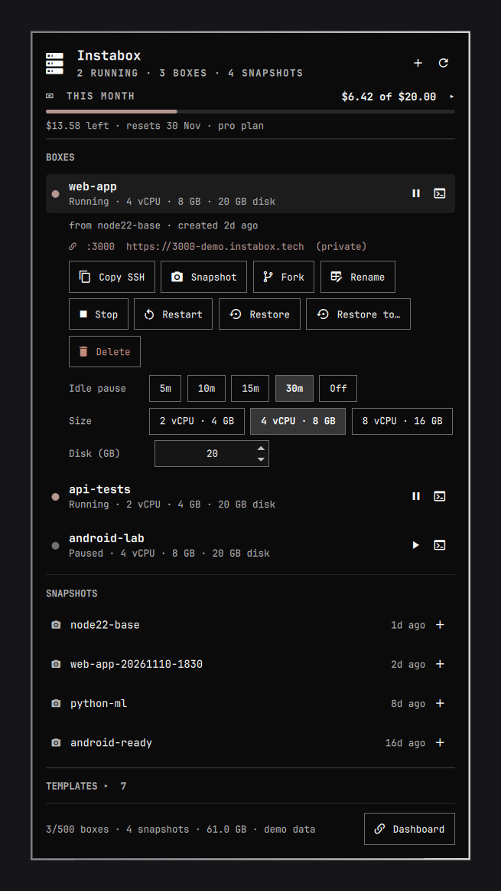

# Instabox Helper

An [Omarchy](https://omarchy.org/) bar plugin for [Instabox](https://instabox.sh) cloud boxes. It shows your boxes, snapshots, base templates and this month's spend in a panel on the bar, so day-to-day work doesn't need the dashboard: one-click SSH, new boxes from a template or snapshot, power, resize, snapshots, forks and more.

It is a front end to the official `instabox` CLI and uses the CLI's own sign-in. The plugin stores no API key, token or password.



*The panel with **Demo data** on (made-up boxes and spend), one box expanded.*

## What it does

**Bar icon.** A server icon that lights up while any box is running, with the count beside it. Left-click opens the panel and right-click refreshes. The tooltip shows how many boxes are running and what you've spent this month.

**This month (billing).** A card at the top shows what the current billing period has cost so far against your plan's allowance, with a progress bar, the credit left and when the period resets: for example *$1.78 of $20.00 · $18.22 left · resets 1 Dec · pro plan*. Click it to see the breakdown (vCPU, memory, storage, GPU, egress) and when usage was last counted (Instabox rates it hourly). Over the allowance, the card turns red and shows the overage.

**New box (the + button).** A form that creates a box from any base template or one of your snapshots:

| Field | Options |
|---|---|
| Start from | The base templates (agent-browser, universal, herdr, orca, t3, omarchy, ci, android, gpu) and your ready snapshots |
| Name | Suggested from the source; must be new |
| Size | The sizes your plan allows (for example 2 vCPU · 4 GB, 4 · 8, 8 · 16) |
| GPU | For the `gpu` template, the GPU type with its size and hourly price. A GPU box asks you to confirm first |
| Idle pause | 5, 10, 15 or 30 minutes, or off |
| Delete after | Never, or 1, 4, 8 or 24 hours (for throwaway boxes) |

**Boxes.** Every box shows its state, size and two buttons:

| Button | What happens |
|---|---|
| Terminal (SSH) | Opens your default terminal and SSHs in. A paused box is resumed first and a stopped one started, so one click is enough. |
| Play / pause | Pause (`instabox suspend`) a running box, or resume/start one that isn't running. |

Click a box to see more: the snapshot or template it came from, when it was made, how full its disks are (while it runs; red from 80%), and links to its published ports. Then:

| Action | CLI | Asks first? |
|---|---|---|
| Copy SSH | copies `instabox ssh <box>` to the clipboard | No |
| Snapshot | `snapshot save <box> --name <name>` | Asks for a name (suggests `<box>-YYYYMMDD-HHMM`) |
| Fork | `fork <box> --name <name>` | Asks for a name (suggests `<box>-fork`) |
| Rename | `rename <box> <new-name>` | Asks for the name |
| Stop | `stop <box>` | Yes |
| Restart | `restart <box>` | Yes |
| Restore | `restore <box> --yes` (back to the snapshot it was made from) | Yes |
| Restore to… | `restore <box> --snapshot <snapshot> --yes` (any snapshot) | Pick a snapshot, then yes |
| Delete | `rm <box> --yes` | Yes |
| Idle pause | `auto-suspend <box> 5m…30m` or `0` | No |
| Size | `resize <box> --vcpus N --mem-mib M --restart` | Yes (it restarts) |
| Disk (GB) | `resize <box> --disk N --restart` (grows live where it can) | Yes |

**Snapshots.** The newest snapshots are listed (8 by default, then "Show all"). The **+** on a row opens the New box form with that snapshot. Click a row to read its description, size and template, or to delete it (`snapshot rm`, asks first).

**Templates.** A collapsible list of Instabox's base templates with their descriptions. The **+** on a row opens the New box form with that template. macOS is listed but can't be created from the panel (see below).

**Footer.** Your usage against your plan's limits, when the list was last refreshed, and a **Dashboard** button for everything else.

Every action sends a desktop notification when it finishes, saying whether it worked and, if not, what the CLI reported. While an action runs, the box's dot pulses and its buttons are disabled; a box being created shows as *creating…* until it appears.

## Requirements

- Omarchy with the Quickshell-based shell (the one with `omarchy plugin` and `~/.config/omarchy/shell.json`).
- The [`instabox` CLI](https://instabox.sh/docs), signed in. Check with `instabox whoami`.
- `python3`, `wl-copy` (for Copy SSH) and `xdg-open` (for links), which Omarchy ships.

Nothing else is installed, and no sudo is needed.

## Install

```bash
omarchy plugin add https://github.com/thelaggingway/Instabox-Helper.git --enable
```

`omarchy plugin add` shows the code warning, clones the repo into `~/.config/omarchy/plugins/wyrdwerk.instabox`, validates it and asks which bar section to use (the default is `right`). Then restart the shell once so the bar loads the new widget:

```bash
omarchy restart shell
```

To place it next to a particular widget:

```bash
omarchy bar put wyrdwerk.instabox --after robzolkos.github
```

### Sign in to Instabox

If the CLI isn't installed or signed in yet:

```bash
npx -y instabox@latest      # installs the CLI to ~/.local/bin and signs you in
instabox whoami             # check
```

If the sign-in expires, the panel shows **Not signed in** and a **Sign in to Instabox** button that runs `instabox login` in a terminal.

**Optional: an API key instead of your account sign-in.** The CLI uses `INSTABOX_API_KEY` from the environment when it is set, and so does this plugin. To limit what the panel can do, create a key with only the scopes you want (`instabox keys create --name omarchy-panel --scope machines:read --scope machines:write --scope images:read`) and put it in the shell's environment, for example in `~/.config/environment.d/instabox.conf`. That file is plain text, so keep it out of dotfile repos. Without the `machines:delete` and `images:delete` scopes, the Delete buttons fail with a permission error instead of deleting. Billing needs an account sign-in or a key that can read usage.

## Settings

Open the plugin's settings from the Omarchy settings panel, or set them in `~/.config/omarchy/shell.json` on the widget's entry:

| Key | Default | Meaning |
|---|---|---|
| `refreshIntervalSec` | `120` | How often to check while the panel is closed. While it is open, or an action is running, it checks every 10 seconds. |
| `maxSnapshots` | `8` | Snapshots listed before "Show all". |
| `showCount` | `true` | Show the number of running boxes next to the icon. |
| `showBilling` | `true` | Show the *This month* card. It costs no extra request. |
| `demoMode` | `false` | Show made-up boxes, snapshots and billing instead of your account, for screenshots and demos. The helper doesn't call the CLI and every action does nothing. |

```bash
omarchy bar set wyrdwerk.instabox refreshIntervalSec 300
omarchy bar set wyrdwerk.instabox demoMode true --json    # booleans need --json
```

## Keyboard and scripting

The panel listens on the IPC target `wyrdwerk.instabox`:

```bash
omarchy-shell wyrdwerk.instabox toggle     # also open, close
omarchy-shell wyrdwerk.instabox newBox     # open the panel with the New box form
omarchy-shell wyrdwerk.instabox refresh
```

To open it with a key, add a line to `~/.config/hypr/bindings.lua`:

```lua
o.bind("SUPER + ALT + I", "Instabox", "omarchy-shell wyrdwerk.instabox toggle")
```

Inside the panel, Esc closes it, Esc cancels a name prompt or the New box form, Enter accepts them, and the arrow keys and Enter drive the confirm dialog.

The helper also works on its own:

```bash
H=~/.config/omarchy/plugins/wyrdwerk.instabox/bin/instabox-panel
$H status | jq .billing
$H catalog | jq '.templates[].id'
$H ssh <box>
$H action new my-box --template universal --size 2/4096 --idle 10 --delete-after 4
$H action snapshot-save <box> <name>
```

## macOS boxes

The `macos` template leases a whole Mac for at least 24 hours, billed whether the box runs or not (about $32–56 minimum, depending on the model). So the panel lists it but doesn't create it, and the helper refuses it. Create one with the CLI (`instabox create --template macos --accept-24h-minimum …`) or the dashboard.

## How it works

```
Panel.qml ──argv──▶ bin/instabox-panel ──argv──▶ instabox CLI ──HTTPS──▶ api.instabox.sh
   ▲                     │
   └──── one JSON ◀──────┘   status: ls + snapshot ls + usage + port ls, in parallel
                             catalog: templates (at start, then every 6 h)
                             disk: df inside a running box (when you expand it)
```

- **`Panel.qml`** draws the bar icon and the panel, polls `instabox-panel status`, runs actions as child processes, and opens SSH with `omarchy-launch-tui`.
- **`bin/instabox-panel`** (Python, standard library only) is the only thing that talks to the CLI. `status` and `catalog` print trimmed JSON. `action` runs one whitelisted command and sends the notification. `ssh` wakes the box and hands over to `instabox ssh`.
- **`Model.js`** holds the pure formatting and labelling logic, tested under Node.

### Security and privacy

- **No secrets.** The plugin reads and stores no credentials; the CLI handles sign-in (`~/.config/instabox/credentials.json`, or `INSTABOX_API_KEY`).
- **No shell strings.** Every process is started with a fixed argument list. Box, snapshot and new names must match `^[A-Za-z0-9][A-Za-z0-9._-]{0,62}$`, and sizes, minutes, hours, disk sizes and GPU types have their own strict checks, before anything runs. So no value can become a flag or a command.
- **Only listed actions and options run.** The helper accepts a fixed set of verbs and `new` options; anything else exits without calling the CLI. macOS creates are refused.
- **Costly or destructive actions ask first:** delete, restore, stop, restart, resize, and any GPU box.
- **Untrusted text is shown as plain text.** Names, descriptions and errors from the API are never rendered as rich text, and only `https://` port links are shown or opened.
- **Network use:** only what the `instabox` CLI does, which is `api.instabox.sh`. That's 4 requests every 2 minutes in the background (configurable), every 10 seconds while the panel is open; 1 for templates at start and every 6 hours; 1 per running box you expand; plus the actions you click. Nothing else is contacted.
- **Data kept:** none. No cache or state file is written.

## Troubleshooting

| Symptom | Fix |
|---|---|
| No icon on the bar after installing | `omarchy restart shell`. Check that it is in the layout with `grep wyrdwerk.instabox ~/.config/omarchy/shell.json`, or add it with `omarchy bar put wyrdwerk.instabox`. |
| Edits or an update don't show | Hot reload doesn't always pick up changes to this plugin; run `omarchy restart shell`. |
| "Not signed in" | Click **Sign in to Instabox**, or run `instabox login` (or `npx -y instabox@latest`). |
| "Can't reach Instabox" | The error text comes from the CLI. Try `instabox ls` in a terminal. |
| No billing card | It needs `instabox usage --json` to return `cost`. Check `bin/instabox-panel status \| jq .billing`. With a restricted API key, usage may not be readable. |
| Templates say "Couldn't load" | Run `bin/instabox-panel catalog`, or `instabox templates`, to see the error. |
| A new box never appears | The notification says why create failed. `instabox ls` and `instabox logs <box>` show what happened; a box that failed to boot may be left stopped. |
| The SSH window closes at once | It stays open with a message when `ssh` fails. If it vanishes, run `bin/instabox-panel ssh <box>` in a terminal to see why. |
| An action failed | The notification shows the CLI's last lines. Run the same `instabox` command in a terminal for the full output. |
| Shell log | `journalctl --user -f -o cat \| grep -i instabox` |

## Update and uninstall

```bash
omarchy plugin update wyrdwerk.instabox && omarchy restart shell
omarchy plugin remove wyrdwerk.instabox
```

## Not included (yet)

These remain on the [dashboard](https://dashboard.instabox.sh/dashboard/machines) or the CLI: macOS boxes, setup scripts and devcontainers on create, environment variables, metadata, max-runtime limits, detailed metrics and logs, publishing ports, secrets, webhooks, workspaces and members, API keys, and `snapshot import` from a Docker image. Invoices and payment methods are on the dashboard; the panel shows only the current period's spend.

## Development

```bash
tests/run.sh        # static checks, the helper against a fake CLI, and Model.js under Node
git clone --depth 1 https://github.com/omacom/omarchy-plugin-marketplace.git /tmp/marketplace
node tests/marketplace-scan.mjs /tmp/marketplace    # the marketplace's security baseline; must say passed
```

The tests never touch a real account: `helper-test.sh` puts a fake `instabox` and a fake notifier on `PATH`. See [AGENTS.md](AGENTS.md) for the layout, conventions and how to add an action.

## License

MIT, see [LICENSE](LICENSE). Instabox is a separate service; this plugin is not affiliated with it.
